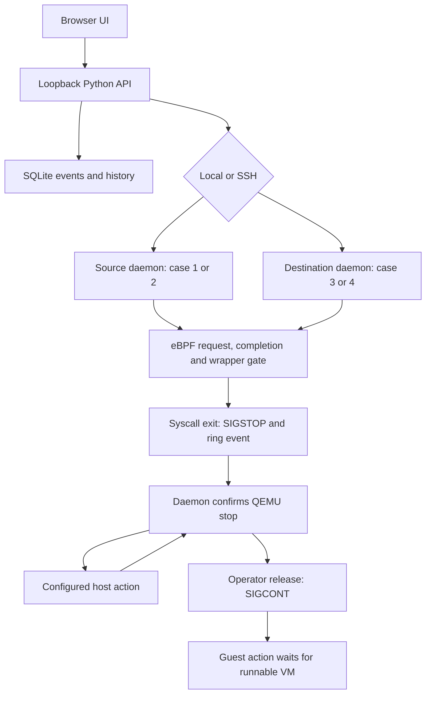
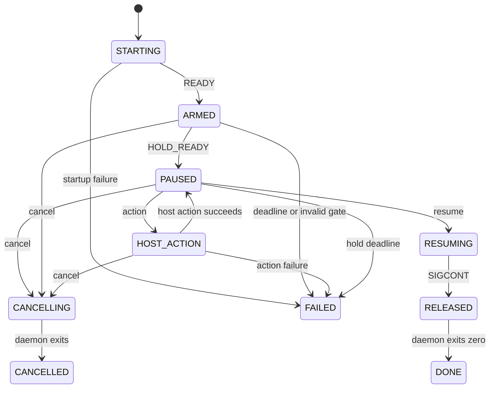

> Legacy reference from the previous UVP console. For this release use [DEPLOYMENT.md](DEPLOYMENT.md) and [ARCHITECTURE_V2.md](ARCHITECTURE_V2.md).

# Backend architecture

The browser uses authenticated same-origin JSON APIs. It never runs BPF or sends signals itself. The Python coordinator chooses the configured local/SSH transport and launches one daemon per run. That daemon owns one QEMU pidfd and one selected checkpoint.

## Event validation inherited from the original framework

`nvme_init_request` captures the issuing TGID/TID and exact request before completion-context handoff. The raw `nvme_complete_rq` tracepoint correlates that request. Wrapper entry/return tracks the complete logical operation, so the first fragment of Get State does not count as full completion. `raw_syscalls:sys_exit` gates only the original issuing thread, rejects incomplete/failed commands and observed later transitions, requests SIGSTOP and publishes the ring event.

The userspace daemon checks full process identity and uses pidfds for signalling. Repeated `/proc/PID/task` snapshots establish observed stopped-thread state. This remains a process-level gate with signal delivery latency, not an instruction-exact global protocol barrier. Another thread or external controller can invalidate the assumption; the framework does not globally serialize QEMU/kernel migration operations.

## Interactive additions

The extended daemon accepts `--control-stdin`, `--hold-timeout`, `--host-action-program` and repeated `--host-action-arg`. In this mode, it emits `HOLD_READY` after confirming the stop, then processes literal newline-delimited commands:

| Input | Effect |
|---|---|
| `action` | Run the configured host argv once while held; return to hold on success |
| `resume` | Disarm the BPF gate, send SIGCONT, and execute the original post-release action |
| `cancel` or EOF | Fail the run and clean up its owned stop/action worker |

No command text or arbitrary arguments are read from stdin. The browser chooses only a configured action ID before arming; the coordinator constructs the fixed command line. The native daemon, not the browser state, is the authority for stop ownership, action ordering and release.

Control stdout and action output are separate. Action stdout is redirected to stderr in the daemon; the Python backend logs stderr without interpreting action text as control events. Only daemon stdout can advance the UI's run state.

While a host action runs, the UI disables release; daemon-level unsolicited `resume` is rejected while the worker is busy. Host action failure, cancellation, timeout, or loss of the observed stop fails the run. The host action gets at most the remaining hold budget and the configured action timeout. The independent watchdog can release on parent death or excessive hold. A reset already applied is not undone.

## Run state machine

Other transport/startup/runtime failures also end in FAILED. Backend restart marks persisted active records INTERRUPTED and refuses to invent ownership of an old process. The UI's migration outcome stays NOT VERIFIED because the backend does not query QMP or validate data.

## Data and concurrency

- One active checkpoint per coordinator, with an RLock around state changes and requests. The daemon adds its per-target lock on the host.
- Only one setup/migration/result job at a time. Setup/result jobs are blocked during an active checkpoint. The migration job is allowed only after READY.
- Duplicate host-action requests and stale run IDs are rejected. The original guest launcher supplies run-id-based launch idempotency.
- SQLite stores run snapshots and timestamped event lines. The UI polls every 900 ms and shows the latest 250 events; JSON export includes all events for the selected run. Disk history is not automatically pruned: archive old databases while the server is stopped.
- Log line fragments are limited to 8192 bytes; longer lines appear as fragments. No HTML from logs is rendered; the UI uses textContent.
- The server binds loopback, requires a bearer token, refuses cross-origin requests and unexpected Host headers, and serves only three fixed asset routes. Operator profiles are trusted and can be privileged; this is not a multi-tenant sandbox.

## Runtime dependencies

Python 3.10+ standard library for the coordinator. Linux pidfd/process APIs and libbpf for the real daemon. A native x86-64 clang BPF build for the object. No Node runtime is required to use the application; `package.json` exists only for optional development preview.

References used for API/build semantics:

- [libbpf overview and CO-RE lifecycle](https://docs.kernel.org/bpf/libbpf/libbpf_overview.html)
- [Python subprocess execution and process sessions](https://docs.python.org/3/library/subprocess.html)
- [Python local HTTP server limitations](https://docs.python.org/3/library/http.server.html)
- [Linux fault injection](https://docs.kernel.org/fault-injection/fault-injection.html)
- The supplied `uvp-live-fio.zip`, its README and validation record, and the existing arm-only timeout script are the project-specific baseline.
