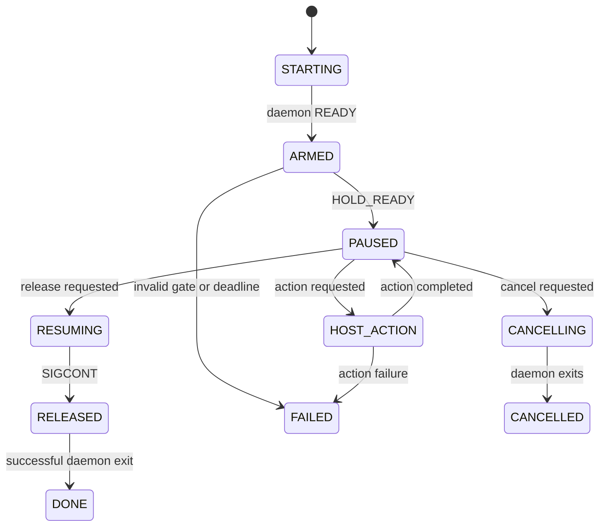

# Controller components and run states

The Linux controller is a C loopback HTTP server with Bash request handlers and worker processes. Both the server-rendered HTML form and the optional dashboard use the same orchestration logic. The full topology, host roles, eBPF gate and failure handling are documented in [Command-triggered orchestration](ARCHITECTURE_V2.md).

## One checkpoint per run

At submission the hook records the issuer’s TGID, TID and process start time. At the matching thread’s syscall exit the daemon receives the event, verifies the process identity with a pidfd, and confirms that the issuer’s threads have stopped before it emits `HOLD_READY`. Its stdin accepts three control messages.

| Message | Daemon behavior |
|---|---|
| `action` | Run the preselected host action once while held |
| `resume` | Disarm the gate, release the owned process and start the configured post-release action |
| `cancel` or channel EOF | End the checkpoint and clean up the owned stop |

Automatic mode uses the same daemon commands. The worker consumes protocol events from daemon stdout and records diagnostic stderr separately. The guest can still be migration-paused after the host process receives SIGCONT.

## State and access

The controller protects its state directory against competing instances, and workers serialize JSON updates with `flock`. Run events can be exported by ID. Restart marks an unfinished checkpoint interrupted so the new controller cannot send signals to a stale PID. The host daemon has an independent bounded watchdog for release if its controller or transport dies.

Windows reaches the loopback service over SSH. The form at `/forms` uses HTTP Basic authentication with username `uvp` and the controller token. The dashboard and automation use the JSON API. Host executables and arguments come from local profiles. [API and daemon protocol](API.md)
