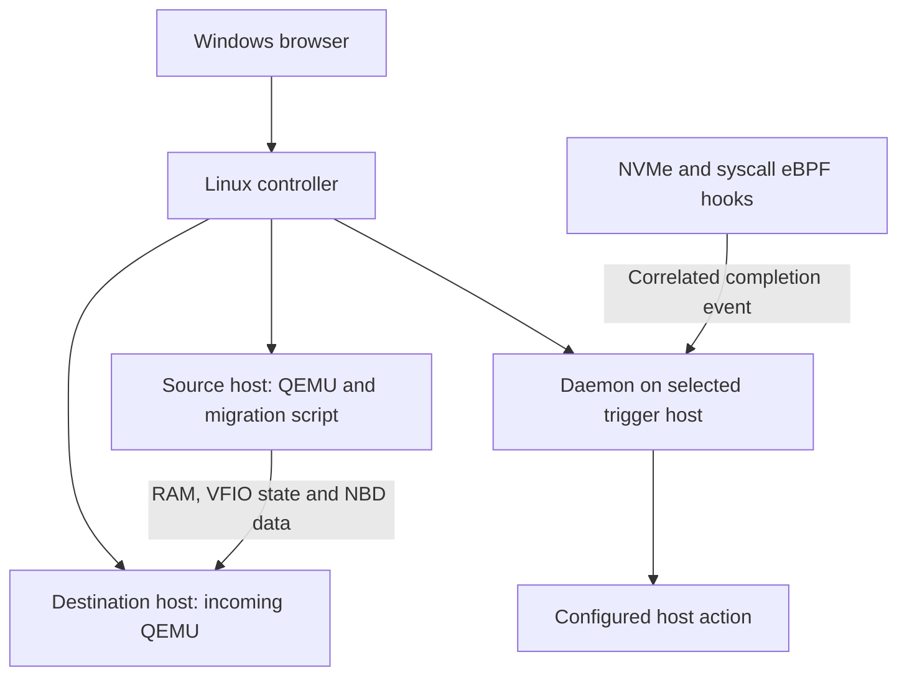

# UVP command-triggered orchestration

The Windows browser selects a command and an action. The Linux controller prepares both hosts, loads the native daemon on the selected trigger host, and starts the source migration script only after the hook is armed. The native daemon owns the QEMU stop, action execution and release. The browser is not in the signal-delivery or action-execution path.

The source and controller may share one physical machine. The source and destination remain separate roles with separate VM identities and controller configuration.

## Configuration and responsibility

| Component | Responsibility | Inputs |
|---|---|---|
| Web UI | Select hosts, command, action and release mode; show state and logs | Authenticated operator selections |
| Python controller | Validate selections; sequence preparation/arming/migration; persist run records | Controller JSON, HTTP requests |
| Host bridge | Execute trusted local preparation/migration commands; verify QEMU identity and readiness | Root-owned `/etc/uvp/host.json`; bounded JSON request |
| C UVP daemon | Load/attach hooks, own target through pidfd, confirm stop, run one action, release | Validated daemon argv and control stdin |
| eBPF programs | Correlate submission/completion/syscall ownership; request one SIGSTOP and emit event | Exact process/device/command selection |
| Existing launchers | Define the real VM, VF, disks, NBD exports and incoming migration service | Host-specific lab configuration |
| Preserved migration v3 script | Root sync, CDQ/baseline/delta transfer, RAM/VFIO migration and final cutover | Source QMP, explicit environment, destination IP |

SSH connects controller to both hosts. The daemon's persistent stdio channel carries control commands and events; its lifetime is not tied to an individual browser request. No browser-supplied executable or arbitrary shell command is accepted.

## Ordered preparation

The **Prepare hosts** operation first prepares destination, then source. The destination launcher must establish its incoming migration service and exports. QMP status must reach `inmigrate`; an existing PID or a QEMU process in `prelaunch` does not establish that readiness. The source must reach `running`.

The bridge checks the configured PID file, executable identity and Unix QMP connection. The QMP socket's actual peer must belong to the expected QEMU process. Preparation returns the verified PID and controller identity to the controller so arming does not rely on an obsolete manually copied PID.

Preparation is not rollback. Existing incompatible processes, stale paths or a failed launch are reported for operator recovery. The bridge does not kill an unknown VM, replace its storage or recreate namespaces automatically.

## One selected checkpoint per run

| Phase | Source | Destination |
|---|---|---|
| Preparation | Running source QEMU | Incoming QEMU and required exports |
| Arm | Daemon here for Suspend/Get or selected source custom command | Daemon here for Set/Resume or selected destination custom command |
| Start migration | Runs configured migration script with destination IP | Receives migration/data |
| Selected command completes | Emits checkpoint only if this host owns the selection | Emits checkpoint only if this host owns the selection |
| Hold/action | Selected QEMU process stopped; configured host action runs once | Selected QEMU process stopped; configured host action runs once |
| Release | Owned SIGSTOP released; migration state machine continues | Owned SIGSTOP released; migration state machine continues |

The two action columns describe alternatives, not simultaneous checkpoints. A new run arms one selected boundary. Multiple independent stop points within one migration require additional coordination beyond this release.

## eBPF ownership and the completion gate

The gate captures the submitting TGID/TID before the request can complete in interrupt or workqueue context. Completion is correlated by the request identity; completion-context PID is not treated as the owner. On the original issuing thread's syscall exit, the gate checks successful operation/completion and emits a one-shot event while requesting SIGSTOP.

The migration presets additionally track a synchronous complete-operation wrapper. This matters for Get/Set controller state: one command completion can represent only part of the transfer. The complete wrapper and all required matching completions must succeed. A later migration transition observed in the same syscall invalidates a requested earlier boundary.

The generic selector requires an opcode and queue class and accepts optional masked NSID/CDW10/CDW11 fields. A zero mask is a wildcard. Its default adapter covers native x86-64 synchronous NVMe passthrough ioctls (`ADMIN_CMD`, `ADMIN64_CMD`, `IO_CMD`, `IO64_CMD`, `IO64_CMD_VEC`) in the selected TGID. Sequential matching requests must all complete; overlapping requests are rejected. An optional server-configured phase symbol can select an audited synchronous integer-returning wrapper for another path.

The default generic path does not support io_uring, compat ioctls, ordinary fio block I/O, asynchronous commands submitted by other tasks, kernel workers or a guest using VFIO passthrough. Those paths need a different adapter. The daemon and BPF object share an ABI and must be built together.

A syscall-exit hook cannot pause execution between two commands already completed inside that syscall. SIGSTOP also has delivery latency and affects the selected process group, not the complete machine or NVMe subsystem. Other host processes and in-flight device work may continue.

## Stop, action and release

The event records submission/completion/syscall details and signal result. The daemon validates the event, uses its existing pidfd identity, and confirms the process's threads are stopped before reporting `HOLD_READY` or executing an action. An event alone is not proof of a completed group stop.

In automatic mode, the controller responds to the confirmed hold by requesting the preselected action once. Successful action completion either requests release automatically or leaves the checkpoint held for manual release, according to the run's setting. Manual mode exposes the same action and release commands through the UI.

The host action executes on the trigger host while the target QEMU process is held. A guest workload cannot be started by guest SSH while that QEMU is stopped; guest work must be prestarted or queued for the point at which the guest becomes runnable. SIGCONT releases the process-level stop but does not send NVMe Resume or force the migration-paused guest to run.

The daemon keeps action output separate from its machine-control stdout. An action printing strings such as `HOLD_READY` must not be able to spoof a control event.

## Independent outcomes

The UI and exported records keep these outcomes distinct:

| Outcome | Evidence | What it does not establish |
|---|---|---|
| Hooks armed | Real daemon loaded/attached and reported readiness | Selected command will occur or hardware migration is correct |
| Checkpoint held | Eligible event and confirmed process stop | SSD or unrelated host processes are stopped |
| Action completed | Configured action exited successfully | Device recovered or data remained intact |
| Checkpoint cycle completed | Daemon released its owned stop and exited successfully | QEMU migration succeeded |
| Migration script completed | Script process result and captured output | Destination guest I/O and data integrity passed |
| Storage/guest validation | Independent workload and integrity checks | Not inferred automatically by this project |

A reset or deletion test can deliberately cause migration failure. Such a result is a useful test observation and must not be relabeled as a successful migration merely because the injection ran.

## Failure containment and persistence

The daemon uses finite checkpoint, action and hold deadlines. Its independent watchdog provides bounded release of the owned stop if the controlling path fails. The controller records events and run state in SQLite. A browser disconnect leaves the daemon/controller active; a daemon stdin/SSH disconnect triggers daemon cleanup. A restarted controller marks unfinished runs interrupted rather than reattaching to an unverified numeric PID.

Cancellation applies to the checkpoint cycle. It does not roll back a reset, undelete a namespace or automatically cancel/recover the QEMU migration. Escaped background descendants and remote actions remain outside process cleanup guarantees. After any failure, inspect both VM/device states before starting another run.

## Security boundary

The web server listens on loopback and checks token, Host and origin. Windows reaches it through an SSH tunnel. SSH host keys are checked strictly; credentials remain on the Linux controller. Configured privileged argv and target devices are trusted operator configuration. Namespace deletion requires explicit target selection/acknowledgement and is disabled by default in hardware examples.

This is a single-operator laboratory controller, not an Internet-facing multi-tenant service. The controller token and accounts authorized to run privileged daemon actions are administrative capabilities. Repository source and examples contain no private SSH key or access token.
