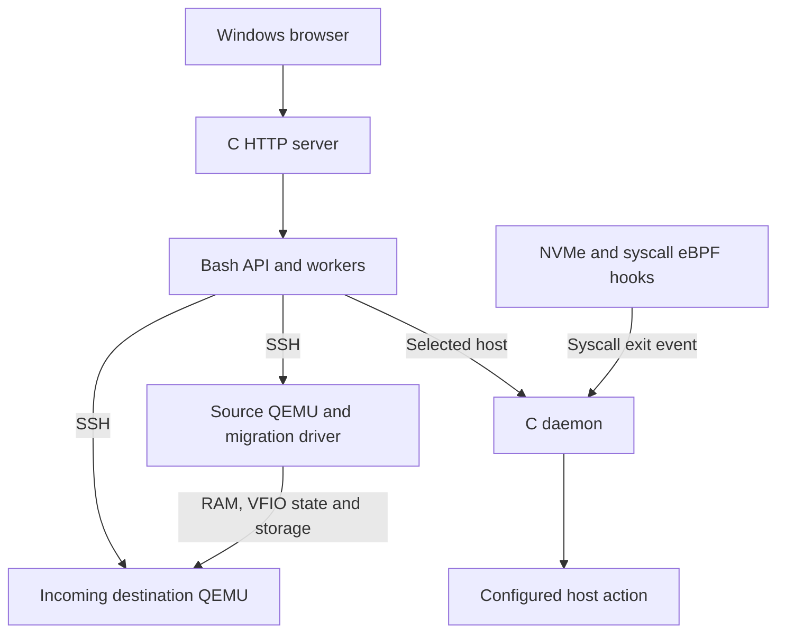

# UVP command-triggered orchestration

The Windows browser selects a command, an action and two Linux hosts. On Linux, a C HTTP server passes requests to Bash handlers. Workers prepare both hosts, arm the selected checkpoint and start the migration. The selected host's native daemon owns the issuing process stop, action and release.

## Which component does what?

| Component | Responsibility |
|---|---|
| C HTTP server | Bind loopback, authenticate, check request origin and framing, route to forms/API/static files |
| Bash form and API handlers | Render HTML, validate selections, serialize state changes, start workers, export results |
| Bash workers and C helpers | Invoke configured local/SSH operations, stream daemon events and control messages, enforce deadlines |
| Host bridge and QMP helper | Read root-owned launcher configuration, verify live QEMU identity and QMP state, serialize migration |
| Native daemon | Attach hooks, hold a target pidfd, confirm the stop, run the selected action once, release the target |
| eBPF hooks | Correlate submission/completion with the originating thread and its syscall, request SIGSTOP and report the decision |
| Existing VM launchers | Establish VF, disks, QMP and NBD exports for the real lab topology |
| Supplied source migration script | Synchronize the root disk, perform CDQ/baseline/delta processing, transfer RAM and VFIO state, cut over |

## Preparation, arming and migration

The destination must first reach `inmigrate` with its incoming service and exports ready. The source must be `running`. The host bridge verifies the PID file and executable, checks the Unix QMP socket's peer PID, and queries QMP. The operator chooses one command and action per run. Source Suspend/Get checkpoints load the daemon on the source, and destination Set/Resume checkpoints load it on the destination.

After the daemon reports `READY`, the controller records `ARMED` and accepts the migration job. It starts on the source with the supplied destination address and the source QEMU identity verified during preparation.

On the selected trigger host, the first matching `nvme_init_request` in the configured synchronous operation captures the issuer’s TGID, TID and process start time. The completion hook uses the request address to find that recorded owner, including when an IRQ or workqueue handles completion. The exit hook compares the current thread with the stored owner and checks the syscall and completion status before requesting SIGSTOP and emitting a ring event. Another thread sharing the TGID cannot trigger the stop on its own syscall exit. Get/Set can span multiple fragments. A later migration transition in the same syscall invalidates an earlier boundary. [Command details](GENERIC_HOOKS.md)

## Action and release

Each Linux host permits one armed hardware daemon at a time. A process can submit commands on several controllers, and a stop affects all its threads. The daemon uses the captured TGID to open a pidfd and verifies a per-run marker attached by eBPF to the original process. It confirms that the issuer’s threads have stopped before reporting `HOLD_READY`. The worker can then send `action` over the persistent control channel to run the program selected at arming. Successful completion returns to held state. An operator or the automatic worker can send `resume`, and the daemon sends SIGCONT and handles any post-release guest job.

Action failure, timeout or control-channel loss can trigger cleanup of the owned stop. A watchdog can release the process if the daemon dies. Hardware may already have accepted a reset or deletion, and kernel/hardware hangs can outlast the control process. An initial checkpoint cycle ending `DONE`, a zero migration-script exit and independently verified guest integrity are three distinct outcomes.

## Persistence and access

State changes use file locking and atomic replacement of JSON within the controller's state directory. Per-run events support export after a browser disconnect. Startup marks an unfinished run interrupted before accepting another. The controller-to-daemon connection has its own lifetime, separate from short-lived browser requests. [State transitions and daemon commands](ARCHITECTURE.md)

The no-JavaScript form at `/forms` uses HTTP Basic authentication with user `uvp` and the printed token. The interactive dashboard and automation use the authenticated JSON API. SSH host-key checking remains enabled for both hardware PCs. The trusted host configuration fixes paths, credentials and action argv. [Two-host installation](DEPLOYMENT.md)
